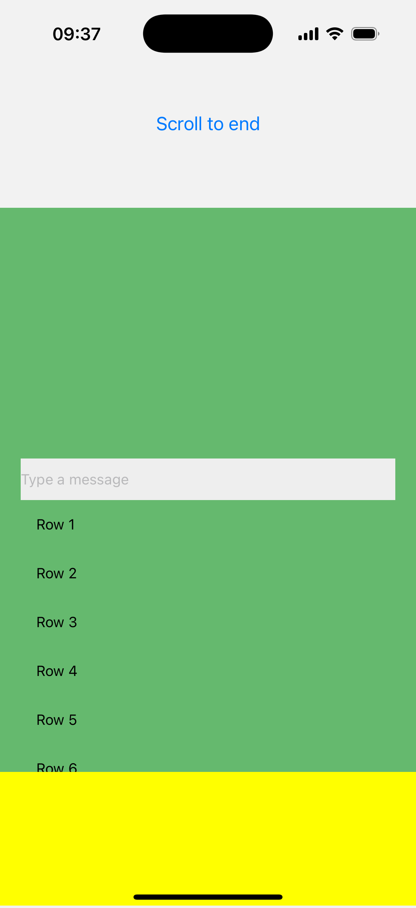
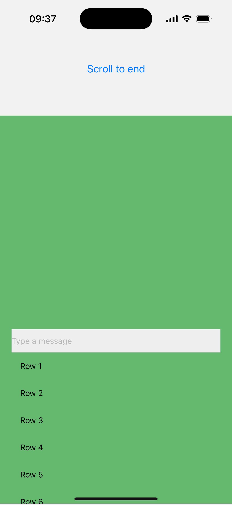

# React Native ScrollView recycling repro

A single `App.js` using React Native Animated and native-stack. iOS only.

Runtime dependencies: React, React Native, @react-navigation/native,
@react-navigation/native-stack, react-native-screens and
react-native-safe-area-context. Standard RN Babel preset; no extra plugins.

## Run

Requires Node >=22.11, Yarn 1, Ruby/CocoaPods and Xcode.

```sh
yarn
bundle install
cd ios && bundle exec pod install && cd ..
yarn start
```

In another terminal, target an existing iPhone 16 Pro Simulator with iOS 18.5:

```sh
yarn ios --simulator "iPhone 16 Pro"
```

Metro uses port 8086. Enable the simulator's software keyboard.
RN 0.87.1/Fabric is pinned. The public RN Experimental release preset in
AppDelegate enables the shared Animated backend and C++ Native Animated, which
allow the native-driven `onScroll` mapping to update `height` synchronously.
The Podfile builds RN Core from source so the optional patch is actually compiled.

## Reproduce

1. Freshly launch the app.
2. Press **Open ScrollView**.
3. Focus **Type a message**; wait for the keyboard.
4. Press **Scroll to end**.
5. Swipe back from the left phone bezel, with the keyboard initially open.
6. Press **Open ScrollView** again.

The green content is shifted upward and a yellow gap appears at the bottom.
The interpolation constants target the tested 402 × 874 pt simulator. On the
second opening the height is static: this exposes the recycled view's retained
geometry instead of attaching a new Animated graph that could repair it.

## Compare the fix

```sh
yarn apply-fix
yarn ios --simulator "iPhone 16 Pro"
```

Repeat the same six steps after rebuilding. To return to the unfixed version:

```sh
yarn revert-fix
yarn ios --simulator "iPhone 16 Pro"
```

The patch adds `_scrollView.frame = self.bounds;` at the end of
`RCTScrollViewComponentView.prepareForRecycle`. It resets the inner UIScrollView
geometry before reuse. The application code is identical before and after.

## Verification

Verified with Argent on **iPhone 16 Pro Simulator / iOS 18.5**, Xcode 27.0.
Both binaries were built from RN source; both published recordings passed the
same complete 24-step flow. The application and dependency lockfiles are identical.

| After swipe-back and reopening | Before | After |
| --- | --- | --- |
| Inner ScrollView frame.y | -128.6667 pt | 0 pt |
| Same native inner and outer views reused | Yes | Yes |
| React tag changes on reuse | 218 → 426 | 218 → 426 |
| Yellow gap | Visible | Absent |

| Before | After |
| --- | --- |
|  |  |
| [Video before](evidence/before.mp4) | [Video after](evidence/after-english.mp4) |

Videos use Argent's static-frame trimming; gesture animation is retained. There
are no custom native probes or runtime frame-reset hooks in the application.
Native autolinking contains only screens and safe-area-context. Incomplete mouse-driven takes that did not dismiss the screen were excluded.
Both published recordings use the English keyboard and confirm dismissal,
reopening and native view reuse.

Raw geometry and source hashes: [evidence/](evidence/).

Related investigation: https://github.com/kirillzyusko/react-native-keyboard-controller/issues/1200
